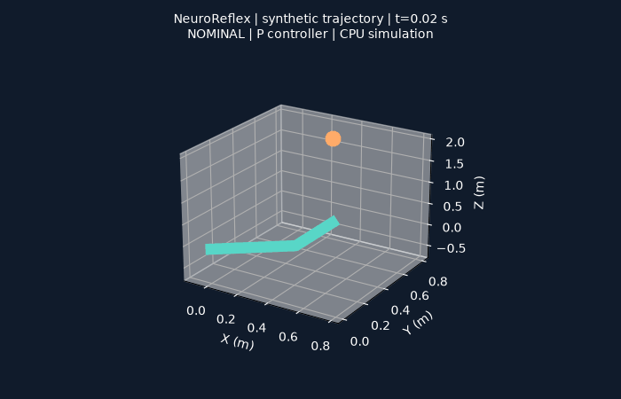
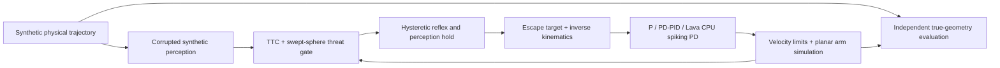

# NeuroReflex ? Event-Driven Neuromorphic Collision Avoidance for Robotic Arms

A personal robotics engineering contribution from the Munich Neuromorphic Hackathon 2026: geometric threat estimation, stateful collision-avoidance reflexes, and classical versus spiking motor control.

## Overview

Robotic collision avoidance needs more than a fast trigger: a reflex must distinguish an approaching obstacle from a harmless pass, respect joint limits, and remain active long enough to avoid returning into danger. NeuroReflex studies these decisions in a small, reproducible arm simulation. Synthetic observations provide obstacle position, velocity, looming, and time to contact. A swept-sphere predictor tests perceived motion against the current arm geometry; a hysteretic state machine controls activation, release, and perception-loss hold. A shared escape target drives either a proportional controller, a stateful PID implementation, or a neural engineering framework realization using spiking populations in Lava. Independent geometry evaluates the resulting encounter against true obstacle motion. This repository contains the author's controller, safety, evaluation, and synthetic-perception contribution. Teammates' event-camera perception engines and the shared challenge GUI are excluded. Results describe simulated encounters; they do not establish physical robot safety, neuromorphic hardware deployment, or energy efficiency.

## Demo



The animation shows the actual arm centre lines and obstacle centre from a fixed 1.2 m/s synthetic encounter. Marker sizes are illustrative; collision evaluation uses sphere/capsule radii. It uses the classical P controller. [Reproduce it](#running-the-demo).

## Key Features

- Perceived swept-sphere collision prediction against both current arm links, combined with a TTC gate.
- Asymmetric activation/release hysteresis, safe-evidence dwell, and a latched pose hold during perception loss.
- Shared escape/IK target generation with P, configurable PD/PID, anti-windup, and joint velocity constraints.
- Lava CPU spiking motor control with LIF populations, fixed NEF transforms, and dual-filter derivative estimation.
- Seeded synthetic trajectories with configurable observation noise, latency, dropout, and velocity corruption.
- Whole-encounter clearance, contact, reaction timing, false-trigger, and state-activation metrics with regression fixtures.

## System Architecture



The synthetic physical and visual-observation interfaces are distinct. The released visual mapping/adapter modules expose an integration boundary; an event-camera looming detector is not bundled. [Architecture](docs/architecture.md) ? [Perception](docs/perception.md).

## Technical Approach

**Perception and safety.** Dynamic TTC uses future plane crossing, with a radial closing-speed fallback for paths parallel to the plane. The geometric gate predicts signed clearance from perceived velocity over a one-second horizon against current arm capsules. The demonstrated stateful policy enters at 30 mm predicted clearance, requires more than 60 mm to release, and accumulates 40 ms of fresh safe evidence with perceived receding motion. Missing observations can preserve the active intent while commanding zero joint velocity. These are explicit simulation policies, not safety guarantees.

**Motor control.** Escape targets and inverse kinematics are shared. The P controller remains the compatibility default. PID supports filtered differentiation, conditional integration, reset on mode changes, and actuator constraints. The frozen conventional reference has `Kp=5.25`, `Ki=0`, `Kd=0.1`; it is therefore a **PD** reference despite the historical `pid` CLI label. The `spiking-pid` option realizes that reference with actual simulated spikes and no active integral term. [Controllers](docs/controllers.md).

**Simulation.** Two planar links of 0.45/0.35 m interact with a 3D obstacle trajectory. Arm and ball radii are 35/55 mm. Control advances every 20 ms; encounter geometry is sampled every 2 ms. Shoulder/elbow limits are 98/130 deg/s before urgency scaling. There is no rigid-body dynamics, contact response, or calibrated sensor model.

## Getting Started

Python 3.10+ is required for the portable CPU simulation. A clean Windows CPython 3.13.6 installation was verified. From the repository root:

```bash
python -m venv .venv
# Windows PowerShell
.venv\Scripts\Activate.ps1
# Linux/macOS alternative: source .venv/bin/activate
python -m pip install -e ".[test,visualization]"
```

The NumPy-only core can be installed with `python -m pip install -e .`. Exact versions exercised in the clean portable environment are in [requirements-validated.txt](requirements-validated.txt). Lava is optional and uses a separate Python 3.10 environment; see [hardware and runtime setup](docs/hardware.md).

## Running the Demo

```bash
python scripts/run_demo.py
python scripts/generate_plots.py
```

The first command needs only the portable core. It writes the encounter CSV and control-tick trace under `outputs/demo/`; the second renders the GIF above using the visualization extra. The verified encounter had no observed contact and 452.05 mm minimum clearance. It is one illustrative case.

A configurable benchmark is also available after installation:

```bash
neuroreflex-benchmark --seed 42 --num-trials 24 --threat-gate geometric_hysteresis --csv outputs/custom.csv
```

Create the output parent directory first. Historical root runner CLIs remain available to preserve experiment compatibility.

## Benchmarks and Results

Reproduce the matched comparison with:

```bash
python scripts/run_benchmarks.py
```

Each row below uses **24 encounters** (12 nominal-arm threats, 12 non-threats), seed 42, six trajectory types, speeds 0.3?2.0 m/s, and a 0.5 s observation tail. All conditions use identical physical paths. Noisy observations use XY sigma 10 mm, relative TTC sigma 0.10, transport delay 20 ms, and 5% acquisition dropout.

| Policy / controller | Observation | Collisions | False triggers / non-threats | Worst clearance (mm) | Median reaction (ms), eligible n |
| --- | --- | ---: | ---: | ---: | ---: |
| TTC only / P | Clean | 0/24 | 5/12 (41.7%) | 110.00 | 621.4, n=8 |
| Memoryless geometry / P | Clean | 0/24 | 0/12 | 4.53 | 621.4, n=8 |
| Hysteretic geometry / P | Clean | 0/24 | 0/12 | 90.28 | 621.4, n=8 |
| Hysteretic geometry / frozen PD | Clean | 0/24 | 0/12 | 90.28 | 621.4, n=8 |
| TTC only / P | Noisy | 0/24 | 5/12 (41.7%) | 110.00 | 1099.8, n=6 |
| Memoryless geometry / P | Noisy | 0/24 | 0/12 | 10.28 | 525.8, n=8 |
| Hysteretic geometry / P | Noisy | 0/24 | 0/12 | 90.28 | 525.8, n=8 |
| Hysteretic geometry / frozen PD | Noisy | 0/24 | 0/12 | 90.28 | 525.8, n=8 |

[Configuration](configs/portable-benchmark.json) ? [CSV evidence and command manifest](benchmarks/results/portable/) ? [Metric definitions](docs/evaluation.md).

Reaction latency begins at entry into a 1.5 m nominal-arm clearance region and ends at a qualifying motor-command deviation. Only nonnegative threat responses enter the median; pre-intrusion responses are excluded and not replaced by zero. These are simulated timestamps at 20 ms resolution, **not CPU execution or sensor-to-motor hardware latency**. The CSVs record all statuses. Worst clearance includes threats and non-threats. This small seeded sample does not establish population-level reliability or a universal policy ranking. No spiking performance or energy comparison is claimed by this table.

## Project Structure

```text
neuroreflex/          # Small package interface and installed scenario/preset resources
*.py                 # Preserved scientific core and historical benchmark entry points
scripts/             # Reproducible demo, matched benchmarks, trace rendering
configs/             # Human-readable benchmark specification
benchmarks/results/  # Minimal fresh evidence supporting the table
benchmark_results/   # Selected immutable historical regression fixtures
neuromorphic_lava/   # Author's Lava CPU motor graph
examples/            # Small programmatic reflex example
tests/               # Portable controller, safety, and evaluation regressions
docs/                # Architecture, methods, validation, scope, and limitations
.github/workflows/   # Portable CPU CI
```

The flat core is intentional: preserving imports and numerical behavior is more useful here than a cosmetic module migration. Packaging explicitly lists the releasable modules. Development branches and historical media are not merged into this release.

## Testing

```bash
python -m pytest -p no:cacheprovider
```

The clean portable environment passed **153 tests**, with **16 optional Lava tests skipped**. In the existing Python 3.10/Lava CPU environment, `python -m unittest discover -s tests -p test_spiking.py -v` passed all **20 tests**, including the 16 graph tests. Eight matched benchmark conditions (192 encounters) and the headless demo completed successfully. [Validation details, failures, and unexecuted checks](docs/validation.md).

## Limitations

- A simplified velocity-driven planar arm and finite-resolution geometry do not model a physical robot's dynamics or certify collision freedom.
- Observation corruption is a synthetic robustness tool, not measured event-camera noise.
- Geometric prediction freezes the arm over its horizon; perception-loss pose hold can still collide with an approaching obstacle.
- Lava executes floating-point process models on CPU. Hardware topology export is exploratory; Loihi 2 deployment and energy/latency benefits are unverified.
- Teammates' event-camera perception engines, recordings, the shared GUI, and complete historical studies are excluded from this personal release.

See [limitations](docs/limitations.md) and [release scope](docs/release-status.md).

## Background

Developed during the **Munich Neuromorphic Hackathon 2026**, inspired by the **NEURA Robotics** collision-avoidance challenge. This personal portfolio repository is not an official product or endorsement by the organizers, NEURA Robotics, Intel, or Lava contributors.

## References

- Zaidel, Shalumov, Volinski, Supic, and Tsur (2021). [Neuromorphic NEF-Based Inverse Kinematics and PID Control](https://doi.org/10.3389/fnbot.2021.631159). Background reading; its hardware results are not NeuroReflex results.
- [Lava execution documentation](https://lava-nc.org/lava/notebooks/in_depth/tutorial04_execution.html). Runtime terminology and CPU/hardware execution distinction.

## License

**No license grant.** The author has chosen not to assign an open-source license to this code. Public availability does not provide a general reuse or redistribution license. No `LICENSE` file is included. See [CITATION.cff](CITATION.cff) for citation metadata.
